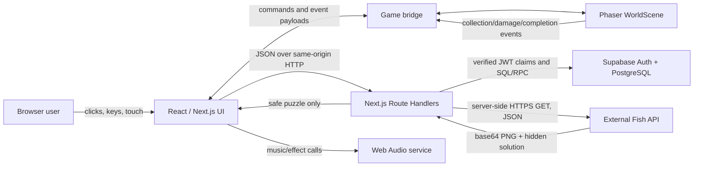

# TreasureHunt Final Viva Preparation Guide

> Current-source audit: 11 November 2026. The implementation at baseline commit `bd8ef77`, plus the final verified cleanup documented in the repository history, is the source of truth. Historical phase documents are not treated as current behavior.

## How to use this guide

- Learn the short **What I say** paragraph in each principle chapter.
- In the viva, open only the files in Part 5 unless the lecturer asks for more detail.
- When describing security, say **the server derives the user ID from verified Supabase claims**. Do not say that a client-supplied user ID is trusted.
- Do not describe Google OAuth, email OTP, or checkpoint Fish challenges as current features. They are absent.

## Lecture sources used

1. `LowCouplingHighCohesionWeek2_AY2425.pptx` - especially slides 2-11, 17 and 27.
2. `eventorientedProgramming_AY2425 (1).pptx` - especially slides 3-10, 14-18 and 21.
3. `event_driven_programming.pdf` - especially pages 11-19, 31-36, 43 and 53-55.
4. `InteroperabilityAY2425_revised.pptx` - especially slides 1, 3-5 and 8-14.
5. `CIS007-3_AY2223_VirtualIdentity(2).pptx` - especially slides 3-9 and 13-14.

---

# Part 1 - Project overview

## 1.1 What TreasureHunt does

TreasureHunt is a three-world browser platform game. The player explores Emerald Jungle, Sunset Ruins and Crystal Cavern, collecting coins, gems and an eight-second Fish power-up while avoiding enemies and a world timer. A run starts with three lives. Worlds 1 and 2 end at Compass Shrines; collecting the final treasure completes World 3. After all lives are lost, the player may solve one external Fish API puzzle to revive once during that run.

The game supports two identities:

- **Registered explorer:** Supabase email/password account, server-verified session, persistent profile, progress, achievements and eligible World 3 leaderboard result.
- **Guest explorer:** temporary in-memory journey progress and achievements for the current page lifetime, no ranked-run submission, plus a signed HttpOnly guest cookie only for Fish challenge ownership.

## 1.2 Architecture and technology stack

| Layer | Current technology | Responsibility | Communication |
|---|---|---|---|
| Web application | Next.js 16 App Router, React 19, JavaScript | Pages, overlays, forms, server Route Handlers and SSR | React props/state, HTTP Route Handlers, server imports |
| Game engine | Phaser 3.90 | Physics, scenes, collisions, animation, input and run state | Small event/command contract through `createGameBridge()` |
| Styling | Tailwind CSS 4 plus `app/globals.css`, Lucide React icons | Responsive dark-green/gold interface | CSS classes and React components |
| Authentication | Supabase Auth, `@supabase/ssr` | Email/password accounts, JWT claims and SSR cookies | HTTPS to Supabase; cookies refreshed in `proxy.js` |
| Persistence | Supabase PostgreSQL | Profiles, progress, achievements, verified runs, leaderboard and Fish challenges | Supabase client queries and server-only RPCs |
| External service | University Fish Game Web API | Generates image puzzle plus fish/chest solution values | Server-side HTTP GET and JSON; base64 PNG sent to browser without solution |
| Audio | Freesound API metadata plus HTMLAudioElement in `lib/audio/audio-player.js` | Validated CC0 music/effects, preference, volume and playback | Internal catalog Route Handler and GameBridge subscribers |
| Testing | Vitest 5, SQL pgTAP-style tests, ESLint 9 | Deterministic domain rules, adapters, security boundaries and UI contracts | Direct module tests and SQL policy tests |
| Delivery | Vercel-compatible Next.js build, Git | Production bundling and version history | `npm run build`, repository commits |

Dependency versions are declared in `package.json`. No Auth.js, Prisma, Firebase, Express, Redux or custom password store is used.

## 1.3 How the technologies communicate



The bridge is the important internal interface. Phaser never imports React or Supabase. React receives gameplay events and decides when to update the UI, play audio or call server endpoints. Route Handlers form the trust boundary: they validate JSON, obtain verified identity, call adapters/repositories and return no-store JSON responses.

## 1.4 Main feature flows

- **Gameplay:** a Next.js game page selects world configuration, `GameScreen` creates a bridge and Phaser instance, and `WorldScene` owns physics and run state.
- **Authentication:** registration calls Supabase `signUp()`, clears the temporary session, then asks the user to log in. Login calls `signInWithPassword()`. SSR cookies carry the session; `getClaims()` derives the UUID.
- **Fish revival:** after Game Over, React requests a server challenge. The server calls the Fish API, stores the solution against an authenticated or signed guest owner, and returns only the image and challenge ID. A correct answer causes React to emit `GAME_COMMANDS.REVIVE`; Phaser resumes the existing run.
- **Profile and achievements:** the World Map server page reads the current user's profile/progress/achievements and passes them to `ProfilePanel`. Six badge definitions are local presentation metadata; earned rows and dates come from the database.
- **Leaderboard:** only a verified completed World 3 run inserts a leaderboard entry. The server RPC calculates rank and flags the current user's row. The UI never invents rows.

---

# Part 2 - Complete file and folder structure

## 2.1 Why the main folders are separate

- `app/` contains Next.js routes and page composition because URL handling, SSR and HTTP boundaries belong together.
- `components/` contains reusable React presentation and interaction logic. It consumes contracts but does not own Phaser physics or SQL.
- `game/` contains Phaser-independent domain rules, world data, render helpers, systems and the Phaser scene. This keeps the game engine testable without rendering React.
- `lib/` contains reusable service adapters and domain utilities for audio, authentication, persistence, Fish, HTTP, progress, security, Supabase and validation.
- `supabase/` contains database schema evolution, trusted SQL functions, RLS policies and database-level tests.
- `tests/` contains Vitest tests outside production modules, allowing deterministic testing of rules and adapter boundaries.

## 2.2 `app/` files

| File | Purpose, communications and principle evidence |
|---|---|
| `app/layout.js` | Root HTML layout and metadata; mounts `AudioController`. It belongs at the App Router root and demonstrates focused composition. |
| `app/page.js` | Root route rendering `SplashScreen`; it delegates transition behavior to the component. |
| `app/welcome/page.js` | Client Welcome menu for registered/guest entry and overlays; calls guest-progress start only when guest mode begins. |
| `app/login/page.js` | Server login page; redirects an already verified identity and passes the registration-success flag to `LoginForm`. |
| `app/register/page.js` | Server registration page; prevents authenticated users from opening signup and composes the register form. |
| `app/worlds/page.js` | Server World Map loader; concurrently reads real profile, progress, achievements and leaderboard, or creates a guest view. It is the page-level data coordinator. |
| `app/game/[worldId]/page.js` | Validates the world, guest/auth mode and unlock state before rendering `GameScreen`. It is a server authorization gate. |
| `app/globals.css` | Shared responsive visual system for screens, overlays, profile, badges, leaderboard and gameplay. It contains no domain or persistence logic. |
| `app/api/health/route.js` | Minimal health GET endpoint for deployment checks. |
| `app/api/auth/register/route.js` | Validates signup, checks duplicate username, calls Supabase `signUp()`, signs out the temporary session and returns the Login redirect. |
| `app/api/auth/login/route.js` | Validates credentials, rate-limits, calls `signInWithPassword()` and returns `/worlds` only on success. |
| `app/api/auth/logout/route.js` | Calls Supabase `signOut()` and returns a no-store response. |
| `app/api/profile/route.js` | GET/PATCH profile boundary; derives identity via `getRouteSession()` and restricts username update to `identity.id`. |
| `app/api/progress/route.js` | Returns only the verified user's progress through `player-repository`. |
| `app/api/leaderboard/route.js` | Returns server-ranked entries; passes the verified UUID only to the trusted leaderboard RPC. |
| `app/api/fish/challenges/route.js` | Creates a Fish revival challenge: validates mode/run/world, resolves owner, calls the external adapter and stores the hidden solution. |
| `app/api/fish/challenges/[challengeId]/answer/route.js` | Validates an answer and atomically verifies it against the stored owner/run challenge. |
| `app/api/runs/start/route.js` | Authenticated-only verified-run start; parses world request and calls trusted `start_verified_game_run_admin`. |
| `app/api/runs/[runId]/events/route.js` | Accepts validated collectible/combat evidence for an owned run through a server RPC. |
| `app/api/runs/[runId]/complete/route.js` | Validates stored evidence and calls the atomic completion RPC that updates progress, achievements and leaderboard. |

## 2.3 `components/` files

| File | Purpose, communications and principle evidence |
|---|---|
| `components/audio/audio-controller.js` | Routes pathname changes and preferences to the single audio service. |
| `components/auth/auth-form-shell.js` | Shared themed shell for Login/Register; keeps layout separate from authentication behavior. |
| `components/auth/form-field.js` | Accessible label, hint and error wrapper reused by both forms. |
| `components/auth/password-input.js` | Password visibility state and accessible toggle; preserves browser autocomplete. |
| `components/auth/login-form.js` | Client validation, duplicate-submit guard, Login POST, success/error display and redirect. |
| `components/auth/register-form.js` | Username/email/password/confirmation state and Signup POST; confirmation remains client/server validation-only. |
| `components/game/game-screen.js` | Main React-Phaser coordinator. It subscribes to bridge events, updates UI/audio, sends evidence, persists completion and opens Fish revival. |
| `components/game/fish-challenge-panel.js` | Requests, displays, resends and answers Fish puzzles; calls `onApproved` only when server returns `revivalGranted: true`. |
| `components/game/game-flow.js` | Pure helpers for introduction, next-world selection and revive countdown. |
| `components/game/how-to-play.js` | Reusable rules/instructions view. |
| `components/game/mobile-controls.js` | Converts pointer input into bridge `INPUT` command payloads. |
| `components/leaderboard/leaderboard-panel.js` | Presents real ranked entries, top-three medals, run statistics, current-player highlight and guest restriction. |
| `components/overlays/about-overlay.js` | Stateful About/How-to content tabs. |
| `components/overlays/game-overlay.js` | Accessible modal, Escape handling, focus trap and focus restoration. |
| `components/profile/profile-panel.js` | Explorer identity, real stats, six interactive badge states, username PATCH and logout. |
| `components/screens/splash-screen.js` | Preloads essential art, enforces bounded splash timing and navigates to Welcome. |
| `components/settings/settings-panel.js` | Music/effects/volume controls connected to the audio preference store. |
| `components/ui/adventure-shell.js` | Reusable themed page shell. |
| `components/ui/floating-motes.js` | Decorative background particles only. |
| `components/ui/game-button.js` | Shared button/link variants with disabled behavior. |
| `components/worlds/use-guest-world-progress.js` | React subscription adapter around guest progress. |
| `components/worlds/world-map.js` | Interactive world selection, unlocking, preload/navigation and Profile/Leaderboard/Settings overlays. |

## 2.4 `game/` files

| File | Purpose, communications and principle evidence |
|---|---|
| `game/config/worlds.js` | Canonical three-world metadata and fixed run rules: lives, timers, fish duration and maximum revive. |
| `game/config/levels.js` | Registry returning the selected world's level configuration. |
| `game/config/emerald-jungle.js` | World 1 platform, collectible, enemy, objective and motion data. |
| `game/config/sunset-ruins.js` | World 2 data, reusing the shared motion contract. |
| `game/config/crystal-cavern.js` | World 3 final-treasure data, reusing the shared motion contract. |
| `game/core/events.js` | Frozen public names for Phaser-to-React events and React-to-Phaser commands. |
| `game/core/game-bridge.js` | Small publish/subscribe dispatcher with `on`, `emit` and `destroy`. |
| `game/core/run-state.js` | Stateful score/lives/timer/collectible/revive rules and immutable snapshots. |
| `game/core/combat-state.js` | Fish-power timing and projectile cooldown rules. |
| `game/core/input-state.js` | Merges keyboard/touch pointer sources and releases controls safely. |
| `game/core/collision-rules.js` | Pure stomp, one-way platform and fall-boundary predicates. |
| `game/create-game.js` | Phaser configuration factory connecting parent, world, level and bridge to `WorldScene`. |
| `game/preload-gameplay.js` | Browser-level deduplicated asset preloader used before navigation/game creation. |
| `game/render/load-assets.js` | Phaser asset loader for the selected world's art contract. |
| `game/render/create-textures.js` | Texture frame, animation and visual alignment helpers. |
| `game/render/backdrop-layout.js` | Pure cover-layout calculation for responsive panoramas. |
| `game/scenes/world-scene.js` | Phaser orchestrator: creates systems, binds commands, detects collisions, mutates run state and emits gameplay events. |
| `game/systems/player-controller.js` | Player sprite movement, animation and input response. |
| `game/systems/enemy-system.js` | Enemy creation, patrol updates and defeat removal. |
| `game/systems/projectile-system.js` | Projectile pooling, firing and cleanup. |
| `game/systems/camera-controller.js` | Camera follow, bounds and resize behavior. |

## 2.5 `lib/` files

| File | Purpose, communications and principle evidence |
|---|---|
| `lib/audio/audio-player.js` | Cohesive HTML audio/persistence service for music, bounded effects, preferences and volume. |
| `lib/auth/client-api.js` | Browser JSON POST helper and bounded retry helper for important game mutations. |
| `lib/auth/errors.js` | Maps Supabase error codes to safe public text. |
| `lib/auth/request-guard.js` | Reusable route rate-limit check using request-derived keys. |
| `lib/auth/route-session.js` | Builds server Supabase client and returns configuration plus verified identity. |
| `lib/auth/session.js` | Converts validated `getClaims()` output into immutable `{id,email}` identity. |
| `lib/data/player-repository.js` | Read-only repository for profile, progress, achievements and leaderboard RPC. |
| `lib/fish/fish-service.js` | Server Fish API adapter: URL, timeout, GET parameters, JSON parsing, image allow-list and safe errors. |
| `lib/fish/challenge-identity.js` | HMAC-signed guest UUID cookie creation/verification and UUID validation. |
| `lib/fish/challenge-owner.js` | Maps authenticated claims or signed guest cookie to a server owner key. |
| `lib/fish/challenge-repository.js` | Server-only database insert and atomic answer-verification RPC. |
| `lib/game/achievements.js` | Six achievement definitions and deterministic guest unlock derivation. |
| `lib/game/gameplay-evidence.js` | Parses run/event/completion payloads and validates stored evidence before completion. |
| `lib/http/responses.js` | No-store JSON responses and object-only JSON body reading. |
| `lib/progress/guest-progress.js` | In-memory guest worlds, collectibles, achievements and observer subscription; removes legacy storage. |
| `lib/security/rate-limit.js` | Per-instance time-window counter and request-key derivation. |
| `lib/supabase/config.js` | Validates public/admin environment variables. |
| `lib/supabase/server.js` | SSR cookie-aware server Supabase client factory. |
| `lib/supabase/admin.js` | Server-only service-role client for narrowly scoped trusted operations. |
| `lib/supabase/proxy.js` | Refreshes SSR auth cookies through `getClaims()` at the proxy boundary. |
| `lib/validation/auth.js` | Pure email, username, login and registration validation including Confirm Password. |

## 2.6 `supabase/` files

| File | Purpose, communications and principle evidence |
|---|---|
| `supabase/migrations/202611050001_create_auth_profiles_progress_and_runs.sql` | Base profiles/progress/achievements/runs/leaderboard schema, signup trigger, RLS, grants and early trusted functions. |
| `supabase/migrations/202611100001_add_fish_revival_challenges.sql` | Fish challenge table and atomic owner-bound verification function. |
| `supabase/migrations/202611100002_add_verified_run_events_achievements_and_rankings.sql` | Verified run events, achievements, atomic completion and ranked leaderboard RPC. |
| `supabase/migrations/202611100003_enforce_run_submission_expiry.sql` | Enforces a bounded run submission window. |
| `supabase/migrations/202611100004_use_current_profile_names_in_leaderboard.sql` | Current leaderboard projection and current-player marker. |
| `supabase/migrations/202611100005_make_run_completion_idempotent.sql` | Current atomic completion implementation fixing repeat completion persistence. |
| `supabase/migrations/202611180001_add_treasure_achievement_milestones.sql` | Adds trusted gem/coin treasure milestones and idempotent backfill. |
| `supabase/tests/phase_2b_rls.test.sql` | Verifies RLS and role grants. |
| `supabase/tests/phase_2b_ownership.test.sql` | Verifies players cannot write another identity's data. |
| `supabase/tests/phase_2b_run_integrity.test.sql` | Verifies run ownership and leaderboard integrity constraints. |

## 2.7 `tests/` files

| File | Purpose |
|---|---|
| `tests/audio-service.test.js` | Persisted audio preference behavior. |
| `tests/auth-route.test.js` | Signup/login/logout Route Handler contracts and Supabase calls. |
| `tests/auth-security.test.js` | Safe errors, identity-bound repository calls and leaderboard privacy. |
| `tests/auth-validation.test.js` | Login/register field rules and password confirmation. |
| `tests/backdrop-layout.test.js` | Responsive background geometry. |
| `tests/client-api.test.js` | JSON mutation retry behavior. |
| `tests/fish-revival.test.js` | Owner binding, signed guest identity and answer route contracts. |
| `tests/fish-service.test.js` | Fish upstream parsing, timeout/error handling and image validation. |
| `tests/game-run-state.test.js` | Lives, scoring, timers, one-revive rule and bridge cleanup. |
| `tests/game-ui-flow.test.js` | Static UI/flow contracts for gameplay, auth, profile and leaderboard. |
| `tests/gameplay-preload.test.js` | Selected-world preload deduplication and failures. |
| `tests/gameplay-systems.test.js` | Level reachability, input, combat and collision rules. |
| `tests/guest-progress-subscription.test.js` | Guest observer notifications. |
| `tests/guest-progress.test.js` | Temporary guest progression and unlocks. |
| `tests/run-validation.test.js` | Server parsing and stored-run completion evidence. |
| `tests/worlds.test.js` | Fixed world order, timers and rules. |
| `tests/server-only-stub.js` | Vitest replacement for Next's server-only marker. |

## 2.8 Relevant root files

| File | Purpose |
|---|---|
| `package.json` / `package-lock.json` | Exact runtime/test dependencies and reproducible lockfile. |
| `next.config.mjs` | Strict React mode and reduced framework disclosure. |
| `vitest.config.mjs` | Alias, Node test environment and coverage configuration. |
| `eslint.config.mjs` | Next/React lint policy. |
| `postcss.config.mjs` | Tailwind PostCSS integration. |
| `jsconfig.json` | JavaScript project and `@/` path alias. |
| `proxy.js` | App-wide Supabase cookie refresh entry point. |
| `.env.example` | Public placeholders for Supabase/Fish configuration; contains no real secrets. |
| `README.md` | Setup and project entry documentation. |
| `AGENTS.md` | Repository development constraints, not runtime code. |

Static art under `public/art/` is runtime content but not code. `.next/`, `node_modules/`, coverage output and temporary browser profiles are generated artifacts and are excluded.

---

# Part 3 - The five principles

## A. High cohesion

### Lecture definition

High cohesion means that a component has focused, well-defined responsibilities. The lecture separates responsibility into **knowing**—holding or deriving closely related information—and **doing**—performing closely related actions (Low Coupling/High Cohesion, slides 6-8 and 27). A cohesive module is easier to reuse, test and maintain.

### How TreasureHunt implements it

The strongest examples are modules whose exports all concern one subject:

- `game/core/run-state.js` knows and changes only run state; `game/config/worlds.js` supplies its fixed rules.
- `lib/fish/fish-service.js` only communicates with and validates the external Fish service.
- `lib/data/player-repository.js` only performs player-data queries.
- `lib/validation/auth.js` only validates authentication input.
- `lib/audio/audio-player.js` owns audio preferences and playback policy.

**Best files to open:** `game/core/run-state.js`, `game/config/worlds.js`, `lib/fish/fish-service.js`, `lib/data/player-repository.js`, `lib/validation/auth.js`.

`game/config/worlds.js:37-41` defines fixed rules, while `game/core/run-state.js:10-63` groups the related state changes:

```js
export const RUN_RULES = Object.freeze({
  lives: 3,
  fishPowerDurationMs: 8_000,
  maxRevives: 1,
});

export class RunState {
  damage(now) {
    if (this.status !== "playing" || now < this.invulnerableUntil) return false;
    this.lives -= 1;
    if (this.lives <= 0) this.status = "game-over";
    return true;
  }
  revive(now) {
    if (this.status !== "game-over" || this.lives > 0 || this.revivesUsed >= this.maxRevives) return false;
    this.lives = 1; this.revivesUsed += 1; this.status = "playing";
    return true;
  }
}
```

Its state methods collect coins/gems, lose lives, activate fish power, revive and return a snapshot. Rendering, HTTP and React are deliberately absent. Therefore deterministic rules can be tested by `tests/game-run-state.test.js` without a browser.

`lib/fish/fish-service.js:46` has one external-service responsibility:

```js
export async function requestFishChallenge({ fetchImpl = fetch, signal } = {}) {
  const response = await fetchImpl(buildFishUrl(), { signal });
  // validate response and return normalized challenge data
}
```

Keeping URL construction, timeout/error translation, JSON validation and image validation together makes the external boundary understandable and independently testable in `tests/fish-service.test.js`.

`lib/data/player-repository.js:1-39` groups related player reads:

```js
export async function getPlayerProgress(supabase, userId) {
  return supabase.from("player_progress").select("*").eq("user_id", userId).maybeSingle();
}
```

Routes decide *who* may request data; this repository decides *how* player records are queried. That separation avoids duplicating query details across UI and routes.

### Why this proves the principle

Each module has one reason to change. A Fish response-format change belongs in the Fish adapter, a scoring-rule change belongs in run state, and an input-rule change belongs in auth validation. Tests can target each responsibility through its small public interface.

**What I say in the viva:** “I used high cohesion by grouping knowledge and actions that belong to the same subject. For example, `RunState` contains gameplay-run state changes but knows nothing about React, Supabase or HTTP. This gives the module one clear reason to change and makes its tests simple.”

**Practical demo:** Open `game/config/worlds.js` for `RUN_RULES`, then `game/core/run-state.js` for `damage`, `revive` and `snapshot`; run `npm test -- tests/game-run-state.test.js`.

**Honest limitation/improvement:** `components/game/game-screen.js` coordinates many concerns—bridge lifecycle, evidence upload, overlays, Fish revival and audio. It is a legitimate orchestration component, but extracting a verified-run hook could make it more cohesive if its behavior grows.

## B. Low coupling

### Lecture definition

Low coupling means minimum necessary dependencies and interactions between modules. Interfaces provide clear gateways, while encapsulation hides internal state (Low Coupling/High Cohesion, slides 3-5, 10-11 and 17). A change behind an interface should have limited impact elsewhere.

### How TreasureHunt implements it

**Best files to open:** `game/core/game-bridge.js`, `game/core/events.js`, `components/game/game-screen.js`, `lib/data/player-repository.js`, `lib/fish/fish-service.js`.

React and Phaser communicate through a tiny interface rather than importing each other's internal state:

```js
// game/core/game-bridge.js:1-22
export function createGameBridge() {
  const handlers = new Map();
  return {
    on(eventName, handler) { /* register and return unsubscribe */ },
    emit(eventName, payload) { /* notify a snapshot of handlers */ },
    destroy() { handlers.clear(); },
  };
}
```

Names are centralized in `game/core/events.js:1-27`, forming an explicit contract. `WorldScene` emits plain payloads such as `COIN_COLLECTED`; `GameScreen` listens and updates React UI/audio. Phaser does not import React, and game rules do not import Supabase.

External and persistence details also sit behind interfaces:

```js
// app/api/profile/route.js
const { supabase, identity } = await getRouteSession();
const result = await getPlayerProfile(supabase, identity.id);
```

The route coordinates authorization; `player-repository.js` encapsulates table queries. Likewise, the Fish route depends on `requestFishChallenge()` rather than knowing the external provider's parsing details.

### Exact connectors

| Boundary | Connector |
|---|---|
| React ↔ Phaser | `game/core/game-bridge.js`, `game/core/events.js`, `components/game/game-screen.js` |
| Browser ↔ server | `lib/auth/client-api.js`, `app/api/**/route.js` |
| Server ↔ Supabase | `lib/supabase/server.js`, `lib/data/player-repository.js` |
| Server ↔ Fish service | `lib/fish/fish-service.js` |
| Next request ↔ verified identity | `lib/auth/route-session.js`, `lib/auth/session.js` |

A source-import graph audit of the current 83 JavaScript modules found 164 internal imports and **zero circular imports**. This is static structural evidence, not a proof that every dependency is ideal.

**What I say in the viva:** “I keep dependencies narrow. React and Phaser exchange named events and plain payloads through `gameBridge`; neither side reaches into the other's internal objects. Server routes use adapters and repositories, so an upstream API or query can change behind a stable function.”

**Practical demo:** Put `game/core/game-bridge.js` and `components/game/game-screen.js:119-131` side by side. Show that the scene emits a string contract and React subscribes without importing the scene.

**Honest limitation/improvement:** `GameScreen` is the main integration point and therefore has many imports. This is expected for an orchestrator, but its API-run coordination could eventually be isolated behind a hook. The event payloads are JavaScript objects, so TypeScript or runtime schemas could make contracts stronger.

## C. Event-driven programming

### Lecture definition

An event-driven system has an **Event Generator**, a **Dispatcher** and one or more **Handlers**. Publish/Subscribe (Observer) lets registered handlers react when a subject publishes instead of polling (Event-Oriented slides 7-10 and 17-18; Event-Driven PDF pages 11-13 and 31-36). Events may carry source and additional information.

### Pattern mapping in TreasureHunt

**Best files to open:** `game/core/events.js`, `game/core/game-bridge.js`, `game/scenes/world-scene.js`, `components/game/game-screen.js`, `lib/progress/guest-progress.js`.

| Lecture role | TreasureHunt implementation |
|---|---|
| Generator | Phaser collisions/input/timer code in `WorldScene`; React mobile controls |
| Event object | Plain payload objects such as `{ id, score, coins }` |
| Dispatcher | `createGameBridge().emit()` |
| Handler registration | `bridge.on()` in `GameScreen`, `PlayerController` and `WorldScene` |
| Cleanup | Unsubscribe functions, `bridge.destroy()`, scene shutdown cleanup |

The event contract is explicit:

```js
// game/core/events.js:1-17
export const GAME_EVENTS = Object.freeze({
  COIN_COLLECTED: "collectible:coin",
  PLAYER_DAMAGED: "player:damaged",
  RUN_ENDED: "run:ended",
  WORLD_COMPLETED: "world:completed",
  RUN_REVIVED: "run:revived",
});
```

The scene generates events:

```js
// game/scenes/world-scene.js:242
this.bridge.emit(GAME_EVENTS.COIN_COLLECTED, {
  id, score: this.run.score, coins: this.run.coins,
});
```

React registers handlers:

```js
// components/game/game-screen.js:122-131
bridge.on(GAME_EVENTS.COIN_COLLECTED, ({ id }) => {
  audioService.playEffect("coin");
  recordEvidence({ type: "coin", id });
});
bridge.on(GAME_EVENTS.WORLD_COMPLETED, (result) => {
  setTerminal({ type: "completed", result });
  persistCompletion(result);
});
```

This is an in-process Observer/Publish-Subscribe implementation. It is not a distributed message broker and has no durable queue; browser events are processed synchronously.

### Real event traces

- **Coin:** Arcade overlap → `collectCoin()` → run state changes → `COIN_COLLECTED` → React plays sound and records evidence → `STATE_CHANGED` refreshes HUD.
- **Enemy collision/life loss:** collision rule decides stomp/damage → `damagePlayer()` → `loseLife()` → `PLAYER_DAMAGED` → damage audio; zero lives then `RUN_ENDED` → Game Over/Fish panel.
- **Game Over:** scene emits `RUN_ENDED`; React pauses audio/game state and displays the terminal overlay.
- **Fish revival:** correct server answer → React emits `GAME_COMMANDS.REVIVE` (`game-screen.js:186`) → scene `reviveRun()` → `RUN_REVIVED` → React closes Fish panel, plays extra-life sound and starts countdown.
- **World completion:** goal overlap → `OBJECTIVE_COLLECTED` then `WORLD_COMPLETED` (`world-scene.js:351-357`) → React persists completion and displays results.

The guest progress store also uses Observer behavior: `subscribeGuestProgress(listener)` registers UI listeners and returns cleanup, while updates publish a new snapshot.

**What I say in the viva:** “My Phaser scene generates gameplay events. `gameBridge` dispatches them, and React handlers update the HUD, audio and server evidence. Commands travel back through the same boundary. This follows generator–dispatcher–handler and Observer patterns without coupling Phaser to React.”

**Practical demo:** Collect a coin, intentionally lose three lives, solve the Fish challenge and finish a world. In VS Code show the emit line in `world-scene.js` and matching handler in `game-screen.js`.

**Honest limitation/improvement:** The bridge is synchronous and memory-only; it provides no queue, replay or cross-process delivery. That is suitable for one browser game session. Server persistence uses HTTP calls rather than this local dispatcher.

## D. Interoperability

### Lecture definition

Interoperability is the ability of different systems to exchange and use information. The lecture analyses **Logic** (what remote function is performed), **Location** (where it is reached) and **Protocol** (how messages are exchanged) (Interoperability slides 1, 3-5 and 9). Web APIs commonly use HTTP plus structured JSON; binary data may be base64 encoded.

### Fish API integration

**Best files to open:** `lib/fish/fish-service.js`, `app/api/fish/challenges/route.js`, `app/api/fish/challenges/[challengeId]/answer/route.js`, `lib/fish/challenge-repository.js`, `components/game/fish-challenge-panel.js`.

| Concept | Current implementation |
|---|---|
| Logic | Obtain a numeric Fish puzzle; verify the player's answer; grant one revive |
| Location | Configured `FISH_API_URL`, default `https://marcconrad.com/uob/fish/api.php` |
| Protocol | HTTPS GET with query `out=json&base64=yes`; JSON response; base64 or allowlisted HTTPS image |

The server adapter makes the external call (`lib/fish/fish-service.js:46`):

```js
const response = await fetchImpl(buildFishUrl(), { signal });
const payload = await response.json();
return parseFishChallenge(payload);
```

The expected upstream fields are `question`, `fish` and `chest`. The adapter validates numeric solutions, accepts a valid PNG base64 signature or an allowlisted Sanfoh HTTPS image, and normalizes failures. Timeout or Fish-service failure returns a controlled error; it must not block world treasure/progression.

`POST /api/fish/challenges` resolves the owner, calls the adapter, stores the solution server-side via `createFishChallenge()`, and returns only challenge ID/image metadata. `POST /api/fish/challenges/[challengeId]/answer` resolves the same owner and run attempt, then calls `verifyFishChallenge()`. The browser never receives the correct solution.

After a correct answer, `FishChallengePanel` invokes its success callback; `GameScreen` emits `REVIVE`; the existing Phaser run continues with one restored life. It does not restart the level. `RunState` enforces at most one Fish revive per run.

This is **external interoperability** because independent systems exchange HTTP/JSON. React–Phaser events are internal module communication, not an external interoperability claim. There are **no checkpoint Fish challenges** in the current implementation; Fish appears only after game over when eligible.

**What I say in the viva:** “The Fish system demonstrates Logic, Location and Protocol. My logic requests a puzzle and validates a solution, its location is a configurable external URL, and its protocol is HTTPS GET with JSON and base64 image data. My Next.js server is an adapter, so the browser never sees the solution.”

**Practical demo:** Lose all lives, inspect the browser network request to local `/api/fish/challenges`, show the image, submit a wrong then correct answer, and show the same run revive. Open `fish-service.js` to explain the upstream boundary.

**Honest limitation/improvement:** Availability and response quality depend on a third party. The code handles timeout/failure safely, but there is no alternate provider. A base64 image increases JSON size. The Fish API is optional rather than a prerequisite for completion.

## E. Virtual identity

### Lecture definition

Virtual identity distinguishes clients and helps prevent impersonation. Because HTTP is stateless, systems add continuity using authentication and session identifiers/cookies. Passwords prove knowledge; cookies preserve a session; external authorities can provide trust (Virtual Identity slides 3-9 and 13-14; Event-Driven PDF pages 53-55).

### Registered identity

**Best files to open:** `app/api/auth/register/route.js`, `app/api/auth/login/route.js`, `lib/auth/session.js`, `lib/supabase/proxy.js`, `supabase/migrations/202611050001_create_auth_profiles_progress_and_runs.sql`.

Registration delegates password storage to Supabase Auth:

```js
// app/api/auth/register/route.js:37-48
const { data, error } = await supabase.auth.signUp({
  email: values.email,
  password: values.password,
  options: { data: { username: values.username } },
});
await supabase.auth.signOut({ scope: "local" });
```

Supabase assigns every account an immutable Auth UUID. Confirm Password is validated but never stored. The temporary signup session is cleared; the UI redirects to login. **Email confirmation is disabled in the Supabase project**, so account creation does not prove ownership of the email address.

Login uses the real Supabase password verifier:

```js
// app/api/auth/login/route.js:24-27
const { error } = await supabase.auth.signInWithPassword({
  email: values.email,
  password: values.password,
});
```

On success, `@supabase/ssr` writes session cookies. `proxy.js` calls `refreshSupabaseSession()` on requests, and `lib/supabase/proxy.js:22` calls `auth.getClaims()` so expired access tokens can be refreshed. A protected route obtains trusted identity as follows:

```js
// lib/auth/session.js:1-11
const { data, error } = await supabase.auth.getClaims();
if (error || !data?.claims?.sub) return null;
return { id: data.claims.sub, email: data.claims.email ?? null };
```

Logout calls `supabase.auth.signOut({ scope: "local" })` (`app/api/auth/logout/route.js:5-10`) and clears the current browser session. OTP and Google OAuth are **not current features**.

### Ownership and trust boundaries

Profiles use the Auth UUID as `id`; progress, achievements and runs use it as `user_id`. Route handlers ignore any client claim about user identity and pass `identity.id` from verified claims. RLS adds database enforcement:

```sql
-- supabase/migrations/202611050001_create_auth_profiles_progress_and_runs.sql:104-110
create policy "players read own progress" on public.player_progress
  for select using (auth.uid() is not null and auth.uid() = user_id);
create policy "players read own achievements" on public.player_achievements
  for select using (auth.uid() is not null and auth.uid() = user_id);
```

Verified completion uses a narrowly granted service-role RPC. The route first authenticates the caller, fetches a run belonging to `identity.id`, validates stored evidence, and then calls `complete_verified_game_run_admin`; the RPC is revoked from public/anon/authenticated and granted only to `service_role` (`202611100002_add_verified_run_events_achievements_and_rankings.sql`).

### Guest identity

Guest gameplay progress is temporary in-memory state and is not merged into a registered account. For Fish challenge ownership only, the server creates a random UUID in a signed HMAC cookie named `treasurehunt.fish-guest`. It is HttpOnly, SameSite Strict and scoped to `/api/fish`; the signature prevents a guest from inventing another owner key. This is a limited pseudonymous identity, not an authenticated account.

**What I say in the viva:** “Supabase Auth gives each registered player a UUID after verifying email and password. SSR cookies carry the session across stateless HTTP requests, but the server still verifies claims and derives the user ID itself. Database foreign keys and RLS bind profile, progress, achievements and runs to that UUID. Guests have only temporary gameplay state and a signed Fish-owner cookie.”

**Practical demo:** Register, observe the success message and login page, fail login with a wrong password, then login correctly. Complete progress, logout, confirm protected data is unavailable, login again and show restored data. With two test accounts, compare UUID-bound rows or API responses to demonstrate isolation.

**Honest limitation/improvement:** Email confirmation is disabled, so the system authenticates possession of a password for an account but does not verify email ownership. Guest progress is intentionally not persistent. The service-role key has broad database power and must remain server-only. RLS is strong for direct user-client reads, while privileged RPC correctness also depends on server authorization and SQL validation.

## 3.6 Implementation status summary

| Status | Evidence |
|---|---|
| Fully implemented | Email/password signup/login/logout; Supabase UUID identity; SSR session refresh; RLS ownership reads; verified run evidence; profile/progress/achievements; real leaderboard; React–Phaser event bridge; optional Fish revival; signed guest Fish ownership. |
| Partially implemented/by design limited | Guest identity is limited to memory plus Fish-owner cookie; event bus is local and synchronous; email is collected but ownership is not verified; third-party Fish availability is not controlled by the app. |
| Absent | Email OTP, confirmation UI, Google OAuth, checkpoint Fish challenges, persistent guest progress, distributed event broker, fake leaderboard players. |

---

# Part 4 - Important end-to-end flows

## 4.1 Register → success → login → World Map

1. `RegisterForm` validates username, email, password and matching confirmation, prevents duplicate submission, and posts to `/api/auth/register`.
2. The route validates again, rate-limits, calls `signUp`, then locally signs out the temporary session.
3. The client navigates to `/login?registered=1`; `LoginForm` keeps “Account created successfully! Please log in to start your adventure.” visible until login begins.
4. Login posts email/password; the route calls `signInWithPassword`. Only success creates SSR cookies and returns `/worlds`.
5. `proxy.js` refreshes/verifies the Supabase session for later requests. Data change: Auth account/profile creation; no gameplay progress changes yet.

## 4.2 Guest → game progress

1. Guest chooses a world from the map and enters `GameScreen` with guest mode.
2. Phaser owns the current run in `RunState`; UI receives bridge events.
3. Completed-world IDs are written to `lib/progress/guest-progress.js` memory and published to `use-guest-world-progress.js` subscribers.
4. Reloading the browser loses this guest progression by design. No Supabase player row is written.

## 4.3 Coin/gem collected → state/UI/achievement

1. An Arcade overlap in `WorldScene` calls `collectCoin` or `collectGem`.
2. `RunState` updates score/count and the scene emits `COIN_COLLECTED`/`GEM_COLLECTED`, followed by `STATE_CHANGED`.
3. `GameScreen` plays the appropriate effect, records a unique evidence event and updates the HUD from state.
4. Evidence is sent to `/api/runs/[runId]/events` for an authenticated verified run.
5. On verified completion, the database RPC derives/unlocks qualifying achievements. Collection alone does not trust a client-supplied final score.

## 4.4 Three lives lost → Fish API → correct answer → revive

1. Damage events call `run.loseLife()`; with zero lives the scene emits `RUN_ENDED`.
2. `GameScreen` shows game-over state and, if the one-revive rule permits, `FishChallengePanel` requests a challenge.
3. The local Fish route establishes authenticated or signed-guest ownership, calls the external service, stores the solution server-side and returns the puzzle.
4. The answer route verifies owner, run attempt and numeric answer. Wrong/expired answers do not revive.
5. Correct verification calls the UI success handler; React emits `REVIVE`; `WorldScene.reviveRun()` restores one life and emits `RUN_REVIVED`. The run and collected state continue rather than restart.

## 4.5 World completion → automatic saved progress

1. Goal collision emits `OBJECTIVE_COLLECTED` and `WORLD_COMPLETED` with the run snapshot.
2. `GameScreen.persistCompletion()` completes the authenticated verified run or updates temporary guest progress.
3. Server completion reloads the caller-owned run/events, validates time and evidence, and executes the atomic completion RPC.
4. The RPC updates progress, profile totals and achievements together. A failed validation does not accept arbitrary client totals.

## 4.6 World 3 completion → leaderboard result

1. World 3 uses the treasure objective and the 90-second timer from world configuration.
2. A validated completion marks the run completed and updates best score/profile data atomically.
3. `getLeaderboard()` reads real eligible results; `/api/leaderboard` requires verified identity and identifies the current user.
4. `LeaderboardPanel` ranks returned records, styles actual top three only and highlights the authenticated player. No placeholder competitors are created.

## 4.7 Logout/login → restore registered progress

1. Sign Out posts to `/api/auth/logout`; Supabase clears the local session cookies.
2. Protected routes no longer receive a verified `claims.sub`, so private profile/progress calls return unauthorized or redirect.
3. A later correct password login creates a new session for the same immutable Auth UUID.
4. Profile/progress/achievement queries use that UUID, so previously stored state reappears. Different accounts resolve to different UUIDs and RLS prevents cross-account reads.

---

# Part 5 - Viva code walkthrough

Use this short sequence; do not open every file.

| Step | File/function to highlight | What happens / principle | What I say |
|---:|---|---|---|
| 1 | `game/config/worlds.js` world configurations | One reusable game supports three rule/data variants; cohesion/reuse. | “The worlds differ through configuration, not copied scenes.” |
| 2 | `game/config/worlds.js` `RUN_RULES`; `game/core/run-state.js` `damage`, `revive`, `snapshot` | Pure deterministic gameplay knowledge/actions; high cohesion. | “The configuration owns fixed rules and this class owns run state, so I can test both without React or Supabase.” |
| 3 | `game/core/events.js` and `game/core/game-bridge.js` `on/emit` | Explicit interface and dispatcher; low coupling/event-driven. | “These names and plain payloads are the contract between modules.” |
| 4 | `game/scenes/world-scene.js:242-263,305,351-363` | Phaser generates collection, damage, completion and game-over events. | “The scene changes game state and publishes facts; it does not manipulate React.” |
| 5 | `components/game/game-screen.js:119-131,186` | React handlers update UI/audio/evidence; command revives the scene. | “React subscribes to events and sends commands back through the bridge.” |
| 6 | `lib/fish/fish-service.js` `requestFishChallenge` | External HTTPS/JSON/base64 adapter; interoperability. | “This isolates Logic, Location and Protocol and validates the untrusted provider.” |
| 7 | Fish challenge and answer routes | Solution stays server-side; owner/run binding; controlled revive. | “The browser receives the puzzle, never the answer.” |
| 8 | `app/api/auth/register/route.js` and `login/route.js` | Supabase signup/sign-out then password login. | “Supabase stores passwords securely; my app never stores Confirm Password.” |
| 9 | `lib/auth/session.js` `getVerifiedIdentity` and `lib/supabase/proxy.js` | Verified JWT claim and refreshed SSR session cookies; virtual identity. | “Every protected request derives the UUID from verified claims.” |
| 10 | auth/progress migration policies at lines 95-117 | `auth.uid()` isolates rows with RLS. | “Even a direct query is restricted to the signed-in UUID.” |
| 11 | run completion route and completion RPC | Stored evidence validation and atomic persistence. | “The server does not trust a client score or user ID.” |
| 12 | `lib/data/player-repository.js` | Focused query interface behind routes; cohesion/coupling. | “Routes authorize; the repository owns query details.” |

Suggested live demo order: register test account → wrong login → correct login → collect coin/gem → lose three lives → wrong/correct Fish answer → complete worlds → view profile/achievements/leaderboard → logout → show protection → login and restore data.

---

# Part 6 - Viva questions and short answers

1. **What is TreasureHunt?**
   A three-world Phaser platform adventure inside Next.js. Players collect coins, gems and Fish power-ups, complete objectives, save verified progress and appear on a real leaderboard.

2. **Why separate `app`, `components`, `game` and `lib`?**
   `app` owns routes/pages, `components` owns React presentation, `game` owns Phaser and deterministic rules, and `lib` owns reusable services/adapters. Each folder has a distinct reason to change.

3. **What is the difference between cohesion and coupling?**
   Cohesion asks whether closely related responsibilities stay together. Coupling asks how much one module depends on another. I aim for focused modules and small interfaces between them.

4. **Where is the event dispatcher?**
   `createGameBridge().emit()` in `game/core/game-bridge.js`; `on()` registers handlers and returns cleanup.

5. **Where are generators and handlers?**
   `WorldScene` collision/input logic generates events. `GameScreen` handlers react by updating UI, audio and evidence; game systems also handle commands.

6. **Is this Publish/Subscribe?**
   Yes, inside the browser process. Subscribers register by event name without the generator knowing them. It is not a distributed broker.

7. **How do you avoid listener leaks?**
   `on()` returns an unsubscribe function, React effects call those cleanups, scene shutdown removes listeners, and bridge destruction clears handlers.

8. **Why use an external Fish API?**
   It demonstrates interoperability and provides a separate puzzle service for an optional revive. The game remains playable if it fails.

9. **What are Logic, Location and Protocol?**
   Logic is getting/validating a Fish puzzle, Location is the configurable external endpoint, and Protocol is HTTPS GET with JSON plus base64/HTTPS image data.

10. **Why use a server-side Fish adapter?**
    It hides the solution, validates untrusted data, applies timeouts and keeps provider-specific details out of the browser.

11. **How does a correct Fish answer revive without restarting?**
    The answer route verifies it, React emits `REVIVE`, and the existing `WorldScene` calls its run state's revive method. The same scene/run continues with one life.

12. **How does Supabase identify a user?**
    Supabase Auth assigns a unique UUID. The verified JWT `sub` claim supplies that UUID to protected server routes.

13. **Why are session cookies necessary?**
    HTTP requests are stateless. SSR cookies carry access/refresh state so the server can recognize and refresh the authenticated session across navigation and reloads.

14. **Do you store passwords?**
    No. Supabase Auth stores and verifies password credentials. The application sends them over the auth call and never stores Confirm Password.

15. **Is email ownership verified?**
    No. Email confirmation is disabled for this assignment, so password authentication works but ownership of that email address is not proven.

16. **Do you support OTP or Google OAuth?**
    No. Those flows were removed; current authentication is email/password only.

17. **What is virtual identity in this game?**
    It is the trusted mapping from a player session to a Supabase UUID, and from that UUID to the player's profile, progress, achievements and runs.

18. **How is Guest mode different?**
    Guest gameplay progress is temporary memory. A signed pseudonymous cookie exists only to bind Fish challenges to the same guest; it is not an authenticated account.

19. **How does RLS protect data?**
    Policies compare `auth.uid()` with a row's owner UUID. A user cannot select another user's private profile, progress, achievements or runs through an authenticated client.

20. **Why also authorize on the server if RLS exists?**
    Defence in depth. Routes reject missing claims and derive the UUID themselves; privileged service-role operations must be checked before bypassing ordinary RLS.

21. **How do you know leaderboard data belongs to the correct user?**
    Completed runs and profile totals are keyed by Auth UUID, server completion verifies a caller-owned run, and the atomic RPC derives leaderboard state from verified completion—not a client username or score.

22. **Can a player submit any score?**
    The server stores run attempts/events, validates completion evidence and duration, and performs an atomic RPC. This reduces trust in a submitted final result, although no browser game can completely prevent a determined modified client.

23. **How do achievements unlock?**
    Verified completion persistence evaluates stored totals/run results and writes user-owned achievement rows. The profile API then reads those actual rows.

24. **Why use world configuration?**
    One scene can reuse behavior while configuration supplies timer, assets, layout and objective differences. It prevents copied world implementations.

25. **Are there circular dependencies?**
    A static audit of current internal JavaScript imports found none. Central contracts and one-directional adapters help maintain that.

26. **What happens if the Fish API is unavailable?**
    The adapter returns a controlled error. Fish revival is optional, so failure never blocks normal treasure collection or world progression.

27. **What security role does the guest cookie have?**
    Its HMAC signature prevents changing the guest owner UUID, HttpOnly blocks normal JavaScript access, SameSite Strict reduces cross-site sending, and the path limits it to Fish routes.

28. **What current limitations remain?**
    Email ownership is not verified, guest progress is not persistent, the local event bus has no durable queue, and the Fish feature depends on an external provider.

29. **How are audio settings separated from gameplay?**
    Gameplay publishes semantic events; the React handler asks `audioService` to play an effect. Phaser rules do not manipulate browser audio preferences.

30. **What would you improve next?**
    I would add typed/runtime-validated event contracts, consider verified email for production, extract verified-run orchestration if `GameScreen` grows, and add provider monitoring—without weakening server ownership checks.

---

# Part 7 - One-page viva cheat sheet

| Principle | Definition | Best evidence | What it proves / what I say |
|---|---|---|---|
| **High cohesion** | Focused “knowing and doing” responsibilities. | `game/config/worlds.js`; `game/core/run-state.js`; `lib/fish/fish-service.js`; `lib/data/player-repository.js` | “Rules, run state, external API parsing and data queries each live in a focused module with one reason to change.” |
| **Low coupling** | Minimum dependencies through interfaces and encapsulation. | `game/core/game-bridge.js`; `game/core/events.js`; `components/game/game-screen.js` | “React and Phaser exchange named events/plain payloads, so neither depends on the other's internals.” |
| **Event-driven** | Generators produce events, a dispatcher routes them, handlers react. | `world-scene.js:242-363`; `game-bridge.js`; `game-screen.js:119-131` | “Phaser generates facts, the bridge dispatches them, and React handlers update UI, audio and persistence.” |
| **Interoperability** | Independent systems exchange usable information through Logic, Location and Protocol. | `lib/fish/fish-service.js`; Fish challenge/answer routes | “My server calls a configurable Fish endpoint over HTTPS/JSON, validates base64/image data and keeps solutions secret.” |
| **Virtual identity** | Authentication plus sessions maintain a trusted client identity across stateless HTTP. | auth routes; `lib/auth/session.js`; `lib/supabase/proxy.js`; RLS migration | “Supabase verifies password credentials, JWT claims identify the UUID, SSR cookies preserve the session, and RLS binds data to that UUID.” |

## Five facts not to get wrong

1. Current authentication is **email/password only**; OTP and Google OAuth are absent.
2. Email confirmation is disabled, so email ownership is not verified.
3. Fish revival occurs after Game Over and at most once per run; there are no checkpoint Fish challenges.
4. Guest progression is temporary; only signed Fish challenge ownership persists in a cookie.
5. The leaderboard contains real verified data only; no fake ranks are generated.

## Final 30-second summary

“TreasureHunt is a Next.js and React application containing a reusable Phaser game. I keep modules cohesive by assigning focused responsibilities, and loosely coupled through events, adapters and repositories. The game is event-driven: Phaser generates events, a bridge dispatches them and React handlers update UI, audio and persistence. The Fish API demonstrates interoperability through HTTPS, JSON and base64 image data behind a server adapter. Supabase Auth, SSR cookies, verified JWT claims, UUID ownership and RLS provide virtual identity for registered players, while guests have deliberately limited temporary identity.”

## Evidence boundary

This guide is based on static inspection of baseline commit `bd8ef77` and the final cleanup diff, plus the five named lecture files. Existing tests provide code-level evidence for the contracts described, but this documentation task did not create new database records. Claims about Supabase Dashboard settings, live RLS behavior and the external Fish provider should be demonstrated with a configured local environment during the viva.
